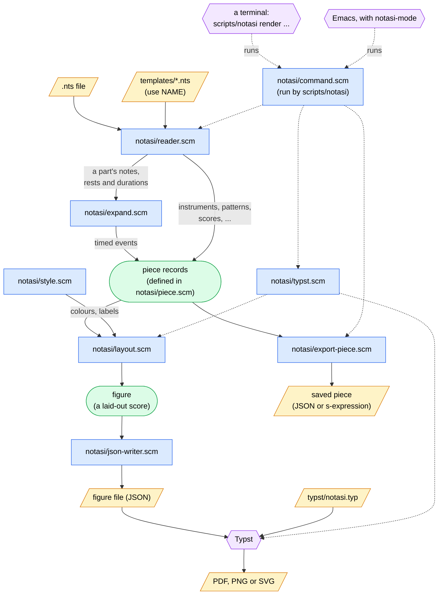

# Contributing to notasi

This file is for people who work on notasi's code, tests and documents. The [README](README.md) is for the people who use it.

## Architecture

A piece goes through notasi in one direction: text is read into a piece, a piece is laid out as scores, and Typst draws the scores. Guile decides everything about a score; Typst only draws it, from a JSON figure file. In the diagram, blue boxes are Guile modules, green rounded boxes are data structures in memory, yellow slanted boxes are files, and purple hexagons are other programs. Solid arrows carry data, labelled where it helps; dotted arrows show which component runs which.

- **reader** parses the notation (`doc/design/01-notation.md`) into piece records, and loads templates with `(use NAME)`. It hands each part's notes, rests and durations to **expand**, which works out when each one starts and how long it lasts: the part's timed events.
- **piece** holds the records everything else works on: instruments, notes, parts, colotomies, patterns and scores. reader and layout meet only there: neither depends on the other.
- **layout** turns each score of a piece into rows, systems and colours (with **style**, which decides how notes look), and **json** writes the result as a figure file, the contract with Typst.
- **typst** writes the figure files and runs Typst on `typst/notasi.typ`, which draws them.
- **save** writes the piece as notasi read it, as JSON or an s-expression (`--save-piece`).
- **command** is the `notasi` command line; `notasi-mode` in Emacs only runs it.

There is no analysis module: notasi draws pieces, it doesn't analyse them.

## Layout

- `notasi/piece.scm`: records for a piece (instruments, notes, parts)
- `notasi/reader.scm`: parses textual notation into a piece
- `notasi/expand.scm`: turns a part's notes, rests and durations into timed events
- `notasi/layout.scm`: lays out scores
- `notasi/json-writer.scm`: writes JSON (the figure files Typst reads)
- `notasi/style.scm`: how notes look: palettes and colour schemes
- `notasi/typst.scm`: the Guile side of the Typst backend: writes figure files and draws them with Typst
- `notasi/export-piece.scm`: saves a piece, as notasi read it, as JSON or an s-expression
- `notasi/command.scm`: the `notasi` command (`scripts/notasi`)
- `tests/`: SRFI-64 test suites
- `examples/`: example pieces, in four folders: `gallery/`, showcase pieces such as Gold's Jaya Semara (`jaya-semara.nts`) and Tenzer's Baris (`baris.nts`), with their drawings in `gallery/images/`; `demos/`, examples of single features; `contrib/`, other people's pieces; and `manual/`, the user manual's examples and drawings. `gallery/` also holds LilyPond files (`.ly`), drawn on a staff for comparison.
- `templates/`: shared scales, stroke sets and instruments, loaded with `(use NAME)`
- `doc/manual/`: the user manual (mdBook)
- `editors/emacs/`: `notasi-mode`, an Emacs package for writing `.nts` files, with the score drawn beside the text
- `LICENSE`: the code is under the MIT licence; `doc/manual/LICENSE` and `examples/LICENSE`: the manual and the examples are under CC BY 4.0, and `examples/LICENSE` lists the examples from published sources

Design documents, decisions and iterations' design ideas are on the `dev` branch: [the design](https://github.com/hsinhaoyu/notasi/tree/dev/doc/design) (the notation language is [01-notation.md](https://github.com/hsinhaoyu/notasi/blob/dev/doc/design/01-notation.md)), [the decision log](https://github.com/hsinhaoyu/notasi/tree/dev/doc/decisions), [iterations](https://github.com/hsinhaoyu/notasi/tree/dev/doc/iterations) (goals, acceptance tests, design ideas and the backlog) and [references](https://github.com/hsinhaoyu/notasi/tree/dev/doc/references).

## Running tests

    make check

`make check` includes golden tests: each piece in `examples/gallery/` and `examples/demos/` is laid out and compared with its saved figure in `tests/golden/`. When you change the output on purpose, run `make golden` to rewrite the saved figures, and review the diff.

Requires Guile 3.0, and Typst 0.15.1 (the tested version) for drawing figures. Run code from the repo root with `guile -L .`.

`make check-emacs` checks the Emacs package in `editors/emacs/`: its tests, byte-compiling, checkdoc and package-lint. It needs Emacs 29.1 or later, and isn't part of `make check`.

`make images` redraws the committed drawings: every score of each piece in `examples/gallery/`, and the figures the manual shows. CI draws them on Linux and fails when one is out of date; a PR that changes how scores look commits the images CI uploads. To draw any one piece, use `scripts/notasi render PIECE.nts --all`.

`make lilypond` draws the gallery's LilyPond files (`examples/gallery/NAME.ly`) into `examples/gallery/images/NAME.png`. It needs LilyPond, and CI doesn't run it: after changing a `.ly` file, run it and commit the image.

## Contributing examples

To contribute an example piece, see the README's [Contributing examples](README.md#contributing-examples).
