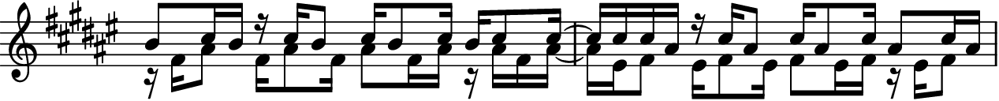
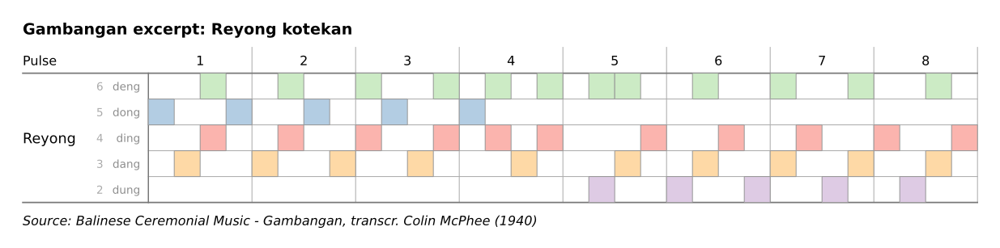

# notasi
<!-- owner: user -->
notasi is a symbolic notation for Balinese gamelan music, and a program that draws it as colourful scores in which the music's structure is easy to see.

This music is full of _kotekan_: interlocking figures in which two parts fit together into one fast, continuous line. The passage below is played on the _reyong_, a row of small kettle gongs. In Western staff notation, the interlocking is lost among stems, beams and rests:



notasi draws the same passage on a grid, with one row for each kettle of the reyong, so you can see at a glance how the two parts fit together:



The score is drawn from a short text file, written in a notation that borrows from the [Scheme](https://en.wikipedia.org/wiki/Scheme_(programming_language)) programming language and from [LilyPond](https://lilypond.org/):

```
(piece "Gambangan excerpt: Reyong kotekan")
(use gong-kebyar)

(part :instrument reyong :name sangsih
  o3:1/4    -   e3  o3 | - e3 o3 - | e3 o3 - e3 | o3    e3  -   e3 |
  -         e3  e3  i3 | - e3 i3 - | e3 i3 - e3 | i3    -   e3  i3 |)

(part :instrument reyong :name polos
  -:1/4     a2  i3  - | a2 i3 - a2 | i3 - a2 i3 | - i3 a2   i3  |
  -         u2  a2  - | u2 a2 - u2 | a2 - u2 a2 | - u2 a2   -   |)

(score kotekan :caption "Source: Balinese Ceremonial Music - Gambangan, transcr. Colin McPhee (1940)"
  (group "Reyong"
    :key-numbers yes
    :row-labels pitch-name
    :row-label-octave no
    sangsih polos))
```

The same notation also works for a whole ensemble:


The notation is concise, so repetitions and variations are quick to write, and the drawing is flexible, so one piece can be shown in different ways for different purposes.

## Who is notasi for?
<!-- owner: user -->

notasi is for teachers and researchers who write about gamelan, and for musicians learning to play it.

notasi is still in development. Its notation may change from one version to the next, so it isn't yet ready for serious composition. For now it is best for short passages; typesetting for whole pieces is planned.

## Installing
<!-- owner: claude -->

notasi needs [GNU Guile](https://www.gnu.org/software/guile/) 3.0 and [Typst](https://typst.app/) 0.15.1, the version it is tested with. The manual gives the commands to [install them](https://hsinhaoyu.github.io/notasi/emacs-installing.html) on macOS and Linux.

Then get notasi itself:

    git clone https://github.com/hsinhaoyu/notasi.git
    cd notasi

## Drawing a score
<!-- owner: claude -->

From the `notasi` folder, draw one of the examples:

    scripts/notasi render examples/gallery/jaya-semara.nts                 # writes examples/gallery/jaya-semara.pdf
    scripts/notasi render examples/gallery/jaya-semara.nts --list          # prints the names of its scores
    scripts/notasi render examples/gallery/jaya-semara.nts --score kotekan # writes examples/gallery/jaya-semara_kotekan.pdf
    scripts/notasi render examples/gallery/jaya-semara.nts --all           # writes examples/gallery/jaya-semara_full.pdf, examples/gallery/jaya-semara_kotekan.pdf, examples/gallery/jaya-semara_collapsed.pdf
    scripts/notasi render examples/gallery/jaya-semara.nts -o jaya-semara.png # writes jaya-semara.png

The first score is drawn unless you name one; `--all` draws them all. [Drawing a score](https://hsinhaoyu.github.io/notasi/drawing.html) in the manual has the rest.

## Using notasi in Emacs
<!-- owner: claude -->

A notasi file is plain text, so you can write it in any text editor and draw it with the commands above. If you use the [Emacs](https://www.gnu.org/software/emacs/) editor, notasi also comes with an add-on for it, `notasi-mode`: it colours the notation as you type, marks mistakes on their lines, and shows the drawn score beside the text, redrawn a moment after you stop typing. The manual's chapter [Writing in Emacs](https://hsinhaoyu.github.io/notasi/emacs-installing.html) says how to install it and use it.

## User manual
<!-- owner: claude -->

The user manual is at <https://hsinhaoyu.github.io/notasi/>. To work on notasi itself, see [CONTRIBUTING.md](CONTRIBUTING.md).

## Licence
<!-- owner: user -->

The code is under the [MIT licence](LICENSE). The [user manual](doc/manual/LICENSE) and the [examples](examples/LICENSE), with their drawings, are under CC BY 4.0. Examples transcribed from published books name their sources, which keep their rights.
