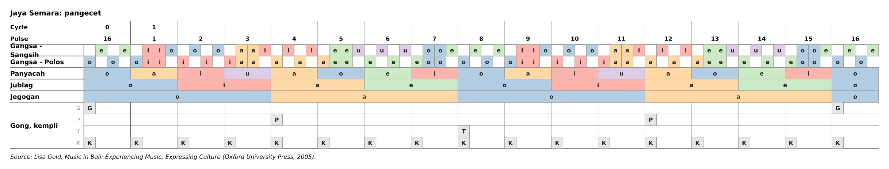

# notasi

Tools for notating and visualizing Balinese gamelan music, written in GNU Guile 3.0.



One gong cycle of Jaya Semara, drawn from
[`examples/gallery/jaya-semara.nts`](examples/gallery/jaya-semara.nts).

## Drawing a score

    scripts/notasi render piece.nts            # writes piece.pdf
    scripts/notasi render piece.nts -o out.png # or .svg
    scripts/notasi render piece.nts --score excerpt  # writes piece_excerpt.pdf
    scripts/notasi render piece.nts --all      # every score, piece_SCORE.pdf
    scripts/notasi render piece.nts --list --save-piece -  # the piece as JSON, nothing drawn

Needs Guile 3.0 and Typst 0.15.1. See "Drawing a score" in the manual.

## Using notasi in Emacs

`notasi-mode` shows the score beside the text as you write, and marks
mistakes on their lines. You need Emacs 29.1 or later, Guile 3.0 and
Typst 0.15.1; the manual gives the commands to
[install them](https://hsinhaoyu.github.io/notasi/emacs-installing.html).

Then add this to your Emacs configuration. It installs the package from
GitHub, with notasi itself, the first time:

```elisp
;; Emacs 30 or later
(use-package notasi-mode
  :vc (:url "https://github.com/hsinhaoyu/notasi"
       :lisp-dir "editors/emacs" :branch "dev"))
```

or, in Emacs 29:

```elisp
(unless (package-installed-p 'notasi-mode)
  (package-vc-install
   '(notasi-mode :url "https://github.com/hsinhaoyu/notasi"
                 :lisp-dir "editors/emacs" :branch "dev")))
```

Open a `.nts` file, such as `examples/gallery/jaya-semara.nts`, and its score
is drawn beside it. The manual's chapter
[Writing in Emacs](https://hsinhaoyu.github.io/notasi/emacs-installing.html)
explains the rest.

## User manual

The manual for musicians is at <https://hsinhaoyu.github.io/notasi/>. Its
source is in `doc/manual/`; build it locally with `make manual`, or preview
it with `make manual-serve`. Both need only [mdBook](https://rust-lang.github.io/mdBook/):
the manual's figures are committed images.

To work on notasi itself, see [CONTRIBUTING.md](CONTRIBUTING.md).
